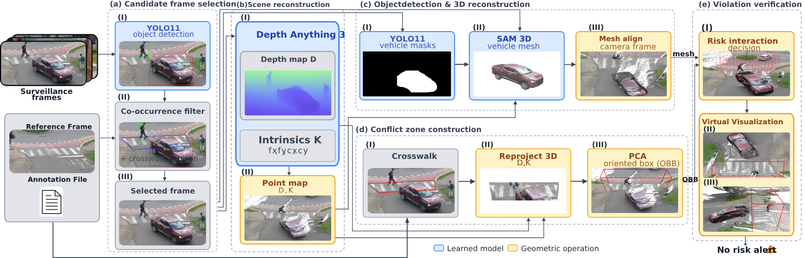
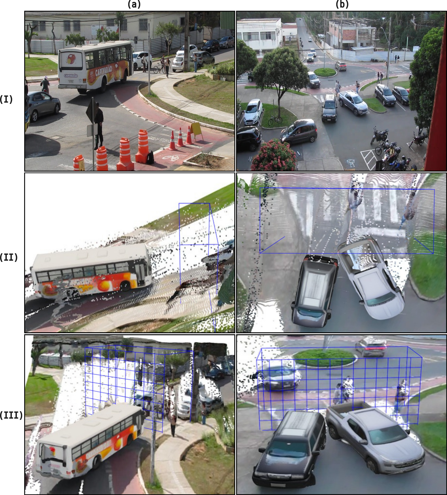

# Pedestrian Crosswalks Surveillance: Mitigating 2D Occlusions through Monocular 3D Reconstruction - SIBGRAPI 2026
Official repository for **Pedestrian Crosswalks Surveillance: Mitigating 2D Occlusions through Monocular 3D Reconstruction** (SIBGRAPI 2026). A 3D pipeline that detects traffic violations at pedestrian crosswalks, flagging frames where a vehicle and a pedestrian occupy the crosswalk at the same time, from a single fixed monocular camera. The dataset used in the paper is available on [Zenodo](TODO).

<p align="center">
  
</p>

The pipeline lifts the 2D scene to 3D and decides violations geometrically, in four stages:

1. **2D Detection and Co-occurrence Filtering:** YOLO detects pedestrians, cyclists and vehicles in every frame and keeps only the detections that touch the crosswalk polygon. A co-occurrence filter then selects only the visually ambiguous frames, where a vehicle and a vulnerable road user appear on the crosswalk together and the 2D image alone cannot tell whether the vehicle actually invades it. Only these frames proceed to the 3D stages.
2. **Monocular Depth and Crosswalk Volume:** [Depth-Anything-3](https://github.com/ByteDance-Seed/Depth-Anything-3) estimates depth and camera intrinsics for each selected frame. The crosswalk corner points are back-projected to 3D, and an oriented bounding box (OBB) is fitted to them to define the enforcement volume above the ground.
3. **3D Vehicle Reconstruction:** YOLO segmentation provides the vehicle mask, and [SAM 3D Objects](https://github.com/facebookresearch/sam-3d-objects) reconstructs the vehicle as a 3D mesh.
4. **3D Violation Test:** a frame is flagged as a violation when the vehicle mesh intersects the crosswalk OBB and a pedestrian is present inside it.

<p align="center">
  
</p>

If you find this work useful for your research, please cite our paper:

```bibtex
@inproceedings{alves2026,
  author = {
    Sarah Alves and
    Júlia Matos and
    Caio Cândido and
    Thiago Gomes and
    Michel Silva
  },
  title = {Pedestrian Crosswalks Surveillance: Mitigating 2D Occlusions through Monocular 3D Reconstruction},
  booktitle = {2026 39th SIBGRAPI Conference on Graphics, Patterns and Images (SIBGRAPI)},
  year = {2026},
  volume={},
  number={},
  doi={}
}
```

## Contact

### Authors

| Sarah Alves* | Júlia Matos* | Caio Cândido | Thiago Gomes | Michel Silva |
|---|---|---|---|---|
| MSc. Student¹ | BSc. Student¹ | BSc. Student¹ | Assistant Professor¹ | Assistant Professor¹ |
| sarah.c.alves@ufv.br | julia.galvao@ufv.br  | caio.candido@ufv.br | thiago.luange@ufv.br | michel.m.silva@ufv.br |

\*Equal contribution.

¹Universidade Federal de Viçosa
Department of Informatics
Viçosa, Minas Gerais, Brazil

## Laboratory

**MaVILab: Machine Vision and Intelligence Laboratory**
https://mavilab-ufv.github.io/

## Acknowledgements

We would like to thank CAPES, FAPEMIG, CNPq, PIBIC-UFV/CNPq, and BICJr-UFV/FAPEMIG for funding differnt parts of this work; and our annotators, Beatriz Gomes, Iasmin da Silva, Leonardo Firmino, Lucas Hermenegildo, Maria Eduarda Bhering, and Sofia de Paula.

## Quick Start
For instructions on how to get started with Pedestrian Crosswalks Surveillance, see the [Quick Start Guide](quick_start.md).
